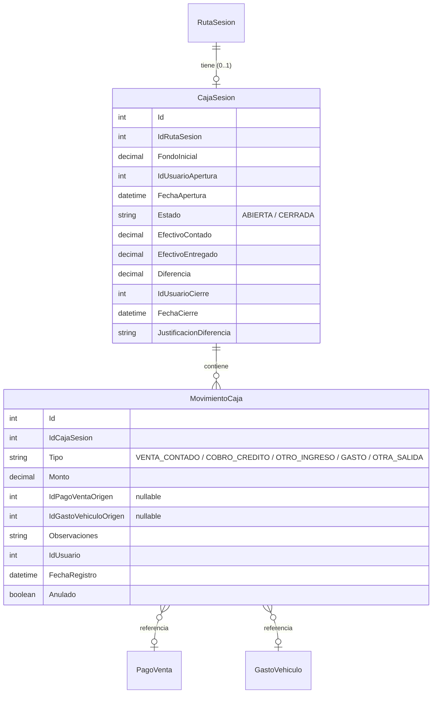

# DISEÑO TÉCNICO DE CAJA — INDUSTRIAS BASAN

**Referencia:** [PLAN_MAESTRO_IMPLEMENTACION.md](./PLAN_MAESTRO_IMPLEMENTACION.md), sección 5. Tareas detalladas en [MATRIZ_TAREAS_TECNICAS.md](./MATRIZ_TAREAS_TECNICAS.md), Fase 3.
**Naturaleza:** propuesta de diseño, no implementación.

---

## 1. Confirmación de ausencia (evidencia directa)

Se buscó en `backend/prisma/schema.prisma` cualquier modelo con nombre `Caja`, `Arqueo`, `CierreCaja` o `MovimientoCaja`: **no existe ninguno**. Se buscó en `backend/src/routes`, `backend/src/controllers`, `backend/src/services` y `backend/src/validators` cualquier archivo relacionado con caja: **no existe ninguno**. Se verificó `rbacModuleKeys` ([role-permission.validators.ts:5-23](/D:/Universidad%20Mariano%20G%C3%A1lvez/FlowManager/backend/src/validators/role-permission.validators.ts)) y `AppModuleKey`/`ALL_MODULES` ([frontend/lib/rbac.ts:3-40](/D:/Universidad%20Mariano%20G%C3%A1lvez/FlowManager/frontend/lib/rbac.ts)): **no existe la clave `caja` en ninguno de los dos catálogos**.

Esta es una ausencia total, no una implementación parcial o con deficiencias.

---

## 2. Fuentes de dinero ya existentes (no duplicar)

| Modelo existente | Qué registra | Campos relevantes | Vínculo con distribución |
|---|---|---|---|
| `PagoVenta` ([schema.prisma:616-634](/D:/Universidad%20Mariano%20G%C3%A1lvez/FlowManager/backend/prisma/schema.prisma)) | Pagos de una venta (contado o abonos de crédito) | `IdVenta`, `IdUsuario`, `Monto`, `MetodoPago`, `NumeroReferencia`, `Banco`, `FechaPago`, `Anulado` | `Venta.IdRutaSesion` (opcional) conecta indirectamente el pago con una sesión de ruta, si la venta se hizo desde un vehículo |
| `CuentaPorCobrar` ([schema.prisma:1161-1186](/D:/Universidad%20Mariano%20G%C3%A1lvez/FlowManager/backend/prisma/schema.prisma)) | Saldo pendiente de una venta a crédito | `IdVenta` (único), `TotalOriginal`, `Estado`, `FechaVencimiento`, `FechaLiquidacion` | Igual que arriba, vía `Venta` |
| `GastoVehiculo` ([schema.prisma:542-565](/D:/Universidad%20Mariano%20G%C3%A1lvez/FlowManager/backend/prisma/schema.prisma)) | Gasto operativo de un vehículo | `IdRutaSesion` (obligatorio), `Monto`, `MetodoPago`, `EstadoPago` (`PAGADO`/`PENDIENTE`), `FechaPago`, `ReferenciaPago`, `NumeroVale` | Directo: siempre vinculado a una sesión de ruta |
| `DetalleGasto` (vía `Compra.EsGasto=true`, [schema.prisma:147-213](/D:/Universidad%20Mariano%20G%C3%A1lvez/FlowManager/backend/prisma/schema.prisma)) | Gasto administrativo registrado como compra | `Descripcion`, `Cantidad`, `PrecioUnitario` | **Ninguno** — no tiene `IdRutaSesion` ni campos de estado de pago |

**Principio de diseño:** el módulo de caja debe **leer y referenciar** estos cuatro orígenes (los tres primeros; el cuarto queda fuera de alcance salvo decisión de negocio, ver sección 6), nunca copiar sus montos a una tabla propia que pueda desincronizarse.

---

## 3. Defecto confirmado que debe corregirse antes de depender de `GastoVehiculo` para el cálculo de caja

Se leyó íntegramente `updateGastoVehiculo` ([logistics.service.ts](/D:/Universidad%20Mariano%20G%C3%A1lvez/FlowManager/backend/src/services/logistics.service.ts)):

```ts
...(input.estadoPago === 'PAGADO' && input.fechaPago === undefined
  ? { FechaPago: new Date() }
  : {}),
```

Este bloque **fija** `FechaPago` cuando el estado pasa a `PAGADO`, pero no existe ningún bloque equivalente que la **limpie** cuando el estado se revierte a `PENDIENTE`. Si un gasto se marca `PAGADO` y luego se corrige a `PENDIENTE`, el registro conserva una `FechaPago` de un pago que ya no es válido. Como el diseño de caja de este documento usa `EstadoPago='PAGADO'` para incluir el gasto en el cálculo de efectivo esperado, este defecto debe corregirse **antes** de que caja dependa de este campo (tarea T-F3-CAJA-04), agregando el caso simétrico:

```ts
...(input.estadoPago === 'PENDIENTE' && input.fechaPago === undefined
  ? { FechaPago: null }
  : {}),
```

---

## 4. Modelo propuesto



### 4.1. `CajaSesion` (nuevo modelo, justificado por la ausencia total descrita en la sección 1)

- **Relación con `RutaSesion`:** 0..1 por sesión (una sesión puede no tener caja si la operación no maneja efectivo, por ejemplo venta solo a crédito; el negocio debe confirmar si esto es posible). Si Fase 2 introduce el concepto de `Jornada` con varios vehículos, debe decidirse si la caja es por vehículo (recomendado, porque el efectivo físico está en manos de una persona/vehículo concreto) o por jornada completa — **decisión de negocio, no técnica** (ver [DECISIONES_TECNICAS_PENDIENTES.md](./DECISIONES_TECNICAS_PENDIENTES.md#caja)).
- **Campos:** fondo inicial, responsable y fecha de apertura; estado (`ABIERTA`/`CERRADA`); efectivo contado, efectivo entregado y diferencia (calculados al cierre); responsable y fecha de cierre; justificación de diferencia (obligatoria si `Diferencia != 0`, según la regla de autorización de diferencias de la especificación).
- **No almacena el efectivo esperado como columna física** calculada una sola vez; se recomienda que el efectivo esperado se calcule dinámicamente desde `MovimientoCaja` (ver sección 5), para que nunca pueda desincronizarse de sus movimientos reales. Si se requiere un valor congelado para el acta de cierre, se almacena como un campo adicional `EfectivoEsperadoAlCierre`, fijado una sola vez en el momento del cierre (no recalculable después).

### 4.2. `MovimientoCaja` (nuevo modelo, justificado porque no existe ninguna bitácora consolidada de efectivo)

- **Resolución de `Monto` (ambigüedad corregida en esta revisión):** `Monto` es una **fotografía inmutable** del importe del origen, tomada en el momento de crear el `MovimientoCaja`, siguiendo el mismo patrón de snapshot ya usado en el resto del esquema (`DespachoRutaDetalle.NombreSnapshot`, `DetalleOrdenProduccion.CantidadTotal`). No se recalcula ni se vuelve a consultar desde `PagoVenta`/`GastoVehiculo` en lecturas posteriores; el campo `Monto` de `MovimientoCaja` **es** la fuente de verdad para el cálculo de efectivo esperado (T-F3-CAJA-03), no un valor "de verificación" adicional. La referencia por id (`IdPagoVentaOrigen`/`IdGastoVehiculoOrigen`) existe exclusivamente para trazabilidad y navegación de auditoría (poder ver el documento origen de cada movimiento), no para recomputar el monto en cada lectura.
  - Justificación: no se encontró, en los servicios ya auditados (`sale.service.ts`, `logistics.service.ts`), ningún endpoint que permita editar el `Monto` de un `PagoVenta` o un `GastoVehiculo` ya creado (solo se anula o se revierte su estado); por tanto, bajo la operación normal del sistema, el snapshot y el registro origen nunca deberían divergir. El snapshot se preserva de todas formas porque es más auditable (el movimiento de caja documenta exactamente lo que se registró ese día, incluso si en el futuro se detecta y corrige un error en el origen mediante una anulación) y evita un `JOIN` obligatorio para cada reporte de caja.
  - Si el negocio llegara a requerir una corrección retroactiva de un `PagoVenta`/`GastoVehiculo` que YA generó un `MovimientoCaja` (más allá de la anulación simétrica de T-F3-CAJA-09), ese es un caso adicional no cubierto por este diseño y debe tratarse como una decisión de negocio pendiente (ver `D-CAJA-07`, política de reversión), no asumirse automáticamente.
- Cada fila referencia su origen por id (`IdPagoVentaOrigen` o `IdGastoVehiculoOrigen`); un mismo `PagoVenta`/`GastoVehiculo` no debe generar más de un `MovimientoCaja` activo (ver sección 4.3, índices únicos filtrados).
- El `Tipo` distingue explícitamente venta de contado, cobro de crédito anterior, otro ingreso, gasto y otra salida — esto implementa directamente la regla de la especificación (sección 10.3): "una venta a crédito no incrementa el efectivo" (no genera `MovimientoCaja` hasta que exista un `PagoVenta` real) y "el cobro de una deuda anterior sí incrementa el efectivo, pero debe identificarse separadamente" (tipo `COBRO_CREDITO`, distinto de `VENTA_CONTADO`).
- Las anulaciones se marcan con `Anulado=true` (mismo patrón que el resto del sistema), nunca se eliminan físicamente; el `Monto` del registro anulado se conserva sin cambios (es historia, no se reescribe), consistente con la resolución anterior.

### 4.3. Implementación y conservación de los índices únicos filtrados (SQL Server + Prisma)

El mecanismo de no duplicidad descrito en T-F3-CAJA-02 requiere que `IdPagoVentaOrigen` sea único **solo cuando no es nulo** (la mayoría de los movimientos tipo `GASTO` tendrán ese campo nulo), y lo mismo para `IdGastoVehiculoOrigen`. Esto es un índice único **filtrado/parcial**, no una restricción `UNIQUE` estándar.

- **Limitación verificada de Prisma Schema Language:** el lenguaje de esquema de Prisma no tiene, para ningún proveedor (incluido SQL Server), una cláusula declarativa equivalente a `CREATE UNIQUE INDEX ... WHERE columna IS NOT NULL`. `@unique`/`@@unique` en `schema.prisma` generan siempre un índice único incondicional. Además, en SQL Server (a diferencia de otros motores) un índice único estándar solo permite **un único valor `NULL`**, no varios; declarar `@unique` directamente sobre `IdPagoVentaOrigen Int?` sin filtro rompería la funcionalidad en cuanto existiera más de un `MovimientoCaja` con ese campo nulo (es decir, en cuanto existiera más de un movimiento de tipo `GASTO`). **Esto debe verificarse contra la versión de Prisma realmente instalada (`backend/package.json`) antes de implementar**, como parte de T-F1-BASE-01, por si una versión futura incorporara soporte nativo.
- **Procedimiento propuesto (a ejecutar bajo el protocolo de T-F1-BASE-06, scripts revisables):**
  1. Declarar `IdPagoVentaOrigen Int?` e `IdGastoVehiculoOrigen Int?` en `schema.prisma` **sin** el atributo `@unique` (porque Prisma no puede expresar la condición filtrada).
  2. Generar el script de migración sin aplicarlo (`prisma migrate dev --create-only`, consistente con T-F1-BASE-06).
  3. Editar manualmente el `migration.sql` generado para añadir los dos índices filtrados con sintaxis nativa de SQL Server, por ejemplo:
     ```sql
     CREATE UNIQUE NONCLUSTERED INDEX UQ_MovimientoCaja_PagoVentaOrigen
       ON MovimientoCaja(IdPagoVentaOrigen) WHERE IdPagoVentaOrigen IS NOT NULL;
     CREATE UNIQUE NONCLUSTERED INDEX UQ_MovimientoCaja_GastoVehiculoOrigen
       ON MovimientoCaja(IdGastoVehiculoOrigen) WHERE IdGastoVehiculoOrigen IS NOT NULL;
     ```
  4. Someter el script combinado (cambio de Prisma + índices manuales) a la revisión y aprobación de T-F1-BASE-06 antes de ejecutarlo.
- **Conservación ante futuras introspecciones/migraciones (riesgo a documentar, no a resolver aquí):** como el índice filtrado no está declarado en `schema.prisma`, Prisma no sabe que existe. Esto implica dos riesgos que deben gestionarse como parte del mismo procedimiento, no ignorarse:
  - Un `prisma db pull` (introspección) posterior podría no reflejar el índice filtrado en el esquema versionado, o un desarrollador podría asumir erróneamente que no hay protección de unicidad al leer solo `schema.prisma`.
  - Un futuro `prisma migrate dev` que genere una nueva migración por diferencias podría, en teoría, intentar una operación sobre la tabla que no anticipe el índice manual.
  - **Mitigación documental mínima:** agregar un comentario explícito sobre el campo en `schema.prisma`, siguiendo el mismo patrón ya usado en el código real para otras estructuras no evidentes (por ejemplo, el comentario existente sobre `MantenimientoVehiculo` como "único activo con identidad propia"), indicando que ese campo está protegido por un índice único filtrado definido manualmente en una migración específica, y referenciando su nombre de archivo.
  - **Mitigación operativa recomendada (no obligatoria para el MVP, sí recomendada para el plan de pruebas):** incluir una verificación periódica o posterior a cada migración (consulta a `sys.indexes`) que confirme que ambos índices filtrados siguen existiendo, como parte de T-F1-BASE-06.

---

## 5. Servicio de cálculo de efectivo esperado

Fórmula de la especificación (sección 10.3):

```
Efectivo esperado = Fondo inicial
                   + Σ MovimientoCaja (Tipo=VENTA_CONTADO, Anulado=false)
                   + Σ MovimientoCaja (Tipo=COBRO_CREDITO, Anulado=false)
                   + Σ MovimientoCaja (Tipo=OTRO_INGRESO, Anulado=false)
                   − Σ MovimientoCaja (Tipo=GASTO, Anulado=false)
                   − Σ MovimientoCaja (Tipo=OTRA_SALIDA, Anulado=false)
```

Propuesta de implementación (`backend/src/services/caja.service.ts`, nuevo):

1. Al registrar un pago de venta en efectivo (`PagoVenta.MetodoPago='EFECTIVO'`, no anulado) vinculado a una venta con `IdRutaSesion` que tiene una `CajaSesion` abierta, generar automáticamente un `MovimientoCaja` tipo `VENTA_CONTADO` o `COBRO_CREDITO` según si la venta es de contado o es un abono a una `CuentaPorCobrar` preexistente. Esta distinción ya existe en el dominio de ventas/créditos (`sale.service.ts`/`credit.service.ts` distinguen venta de contado de abono de crédito); el servicio de caja **reutiliza esa clasificación**, no la reinterpreta.
2. Al marcar un `GastoVehiculo.EstadoPago='PAGADO'` de una sesión con caja abierta, generar un `MovimientoCaja` tipo `GASTO`.
3. El cálculo de efectivo esperado es una consulta de agregación sobre `MovimientoCaja`, no un campo mantenido manualmente.
4. Al cerrar la caja: se captura `EfectivoContado` (ingresado por el responsable de cierre), se calcula `Diferencia = EfectivoContado − EfectivoEsperado`, y si `Diferencia != 0` se exige `JustificacionDiferencia` y un permiso de autorización específico (`caja:update` o una acción dedicada, a decidir).

---

## 6. Relación con el cierre de inventario (independencia obligatoria)

La especificación (sección 10.4.8) exige que el cierre de caja sea independiente del cierre de inventario. Esto ya es consistente con el código actual: `assertRouteCanClose` y `transferVerifiedRouteReturnToPlant` ([route-inventory.service.ts:261-267,729-861](/D:/Universidad%20Mariano%20G%C3%A1lvez/FlowManager/backend/src/services/route-inventory.service.ts)) no tienen ninguna relación con dinero. La propuesta de este documento **no modifica esas funciones**; el cierre de `CajaSesion` es un servicio y un endpoint completamente separados de `updateRutaSesion`. Puede cerrarse el inventario sin cerrar la caja, y viceversa — comportamiento consistente con la especificación, no un defecto a corregir.

---

## 7. Permisos

- Se requiere agregar la clave `caja` a `rbacModuleKeys` (backend) y `AppModuleKey`/`ALL_MODULES` (frontend) simultáneamente (tarea T-F1-BASE-04), siguiendo exactamente el mismo patrón ya usado para `despacho` y `produccion`. **No se crea un mecanismo de permisos nuevo.**
- Acciones recomendadas: `read` (consultar caja/movimientos), `create` (abrir caja, registrar movimiento), `update` (editar movimiento no conciliado, autorizar diferencia), `delete` (anular movimiento/cierre, con motivo).
- La autorización de diferencias (sección 5, punto 4) debe exigir una acción específica verificable en pruebas, análoga a `allow-negative-stock` en producción (que hoy está restringida por `refine` de Zod a un único módulo, [role-permission.validators.ts:32-38](/D:/Universidad%20Mariano%20G%C3%A1lvez/FlowManager/backend/src/validators/role-permission.validators.ts)); se recomienda un patrón equivalente si se decide que "autorizar diferencia" debe ser una acción separada de `update`.

---

## 8. Qué NO se propone

- No se propone crear una segunda tabla de "ventas" o "pagos" dentro de caja. El monto de cada movimiento es una fotografía tomada al momento de registrarlo (sección 4.2); el origen del dinero (`PagoVenta`/`GastoVehiculo`) sigue siendo la única fuente donde se gestiona la venta o el gasto en sí (crear, anular, revertir estado).
- No se propone registrar gastos duplicados: `GastoVehiculo` sigue siendo el único lugar donde se crea, edita o anula un gasto de vehículo; `MovimientoCaja` solo conserva una fotografía de su monto y una referencia a su id, nunca una copia editable independiente.
- No se propone incluir `DetalleGasto` (gasto administrativo de compras) en el cálculo de efectivo esperado por vehículo, porque no tiene vínculo con `RutaSesion` ni estado de pago — se documenta como fuera de alcance salvo decisión de negocio explícita en contrario (tarea T-F3-CAJA-08).
- No se propone que una venta a crédito genere movimiento de caja al momento de la venta (sección 10.3 de la especificación: "una venta a crédito no incrementa el efectivo"); solo el abono posterior (`PagoVenta` real) genera el `MovimientoCaja` tipo `COBRO_CREDITO`.
- No se propone fusionar el cierre de caja con el cierre de inventario de ruta.

---

## 9. Dependencia con el diseño de distribución

Si [DISENO_TECNICO_DISTRIBUCION.md](./DISENO_TECNICO_DISTRIBUCION.md) adopta el modelo de `Jornada` con varios vehículos (sección 4.1 de ese documento), debe decidirse si `CajaSesion` se vincula a `RutaSesion` (una caja por vehículo, recomendado por este documento) o a `Jornada` (una caja consolidada). Esta decisión debe tomarse **antes** de crear el modelo `CajaSesion` en Fase 3, para no migrar dos veces el esquema.
