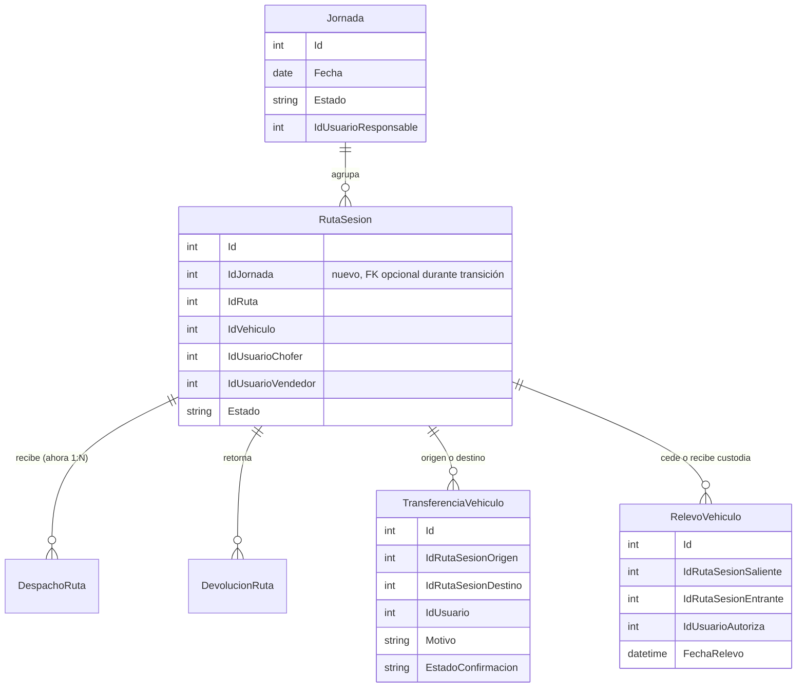

# DISEÑO TÉCNICO DE DISTRIBUCIÓN — INDUSTRIAS BASAN

**Referencia:** [PLAN_MAESTRO_IMPLEMENTACION.md](./PLAN_MAESTRO_IMPLEMENTACION.md), sección 4. Tareas detalladas en [MATRIZ_TAREAS_TECNICAS.md](./MATRIZ_TAREAS_TECNICAS.md), Fase 2.
**Naturaleza:** propuesta de diseño, no implementación. Toda afirmación sobre el comportamiento actual cita el archivo y las líneas verificadas directamente en esta sesión de trabajo.

---

## 1. Por qué la estructura actual es insuficiente (evidencia, no suposición)

El modelo actual de distribución gira en torno a `RutaSesion` ([schema.prisma:1014-1050](/D:/Universidad%20Mariano%20G%C3%A1lvez/FlowManager/backend/prisma/schema.prisma)), que almacena en una sola fila: `IdRuta`, `IdVehiculo`, `IdUsuarioChofer`, `IdUsuarioVendedor`, `FechaSesion`, `KmInicial`/`KmFinal`, `Estado` (`PROGRAMADA`/`EN_CURSO`/`CERRADA`) y datos de cierre. De ella cuelgan `DespachoRuta`, `DevolucionRuta`, `AjusteRuta`, `GastoVehiculo` y las ventas (`Venta.IdRutaSesion`).

Se verificó directamente el código de servicio, no solo el esquema, y se confirmaron tres bloqueos explícitos que impiden los escenarios obligatorios de la especificación (sección 5.4):

### 1.1. Bloqueo de despacho único (impide Escenario A — reabastecimiento)

```ts
// backend/src/services/route-inventory.service.ts:378-382
if (await tx.despachoRuta.findFirst({
  where: { IdRutaSesion: idRutaSesion, Anulado: false },
  select: { Id: true },
})) {
  throw new Error('La sesión ya tiene un despacho confirmado');
}
```

`cancelRouteDispatch` ([route-inventory.service.ts:452-587](/D:/Universidad%20Mariano%20G%C3%A1lvez/FlowManager/backend/src/services/route-inventory.service.ts)) permite anular el despacho único, pero **solo si no existen ventas, devoluciones, ajustes ni movimientos de envase registrados todavía** — es decir, solo sirve para deshacer un error de captura, no para sumar un segundo despacho después de haber operado. No hay ninguna ruta de código que permita a una sesión recibir un segundo despacho mientras ya vendió del primero.

### 1.2. Bloqueo de reasignación tras operaciones (impide Escenario B — sustitución de vehículo)

```ts
// backend/src/services/logistics.service.ts:1009-1021 (aprox.)
const hasOperationalRecords = existing.DespachoRuta.length > 0 || existing.Venta.length > 0;
if (
  hasOperationalRecords &&
  (input.idRuta !== undefined ||
    input.idVehiculo !== undefined ||
    input.idUsuarioChofer !== undefined ||
    input.idUsuarioVendedor !== undefined ||
    input.fechaSesion !== undefined ||
    input.kmInicial !== undefined)
) {
  throw new Error('No se puede modificar la asignación de una sesión con operaciones registradas');
}
```

En cuanto una sesión tiene un despacho o una venta, **no se puede cambiar el vehículo ni el personal asignado por ningún endpoint existente.** No es una omisión de validación: es una regla de negocio ya codificada que protege la integridad de la sesión actual, pero que es incompatible con el requerimiento de sustitución con continuidad.

### 1.3. Ausencia total de transferencia entre vehículos (impide Escenario C)

Se buscó en `schema.prisma` y en `backend/src/services/*` cualquier modelo o función con semántica de transferencia general de inventario comercial entre vehículos. Solo existen:

- `transferEnvaseBucket` ([inventory-movement.service.ts:257](/D:/Universidad%20Mariano%20G%C3%A1lvez/FlowManager/backend/src/services/inventory-movement.service.ts)) — mueve **envases** entre buckets de ubicación/estado (PLANTA/RUTA/CUARENTENA × VACIO/LLENO/DAÑADO), no productos comerciales en general, y no tiene flujo de confirmación de recepción por un tercero.
- `transferVerifiedRouteReturnToPlant` ([route-inventory.service.ts:729-861](/D:/Universidad%20Mariano%20G%C3%A1lvez/FlowManager/backend/src/services/route-inventory.service.ts)) — mueve inventario de **ruta a planta** (no vehículo a vehículo) como parte del cierre de sesión.

No existe transferencia vehículo-a-vehículo en ninguna forma.

### 1.4. Conclusión de esta sección

No se trata de mejorar una funcionalidad incompleta: **el código actual impide activamente** los tres escenarios obligatorios. Cualquier diseño que intente lograrlos "editando" el comportamiento actual de `updateRutaSesion`/`createRouteDispatch` sin cambiar el modelo conceptual va a chocar con estas validaciones, que además protegen invariantes reales (no se puede, por ejemplo, reasignar un vehículo a mitad de una venta sin perder trazabilidad). La propuesta de este documento **añade capacidades nuevas en vez de relajar las validaciones existentes**.

---

## 2. Qué se reutiliza sin cambios de contrato

| Elemento existente | Se reutiliza para | Por qué es suficiente |
|---|---|---|
| `Ruta` | Catálogo de rutas comerciales | No tiene relación con el problema de jornada/vehículo/custodia; no requiere cambios. |
| `RutaSesion` (como registro de **un vehículo operando en una fecha**) | Sigue siendo la unidad de asignación vehículo+personal+fecha | El problema no es que `RutaSesion` sea inútil, es que hoy se le exige hacer de "jornada completa" además de "asignación de un vehículo". Separar ambos conceptos resuelve el problema sin descartar la entidad. |
| `DespachoRuta`/`DespachoRutaDetalle` | Sigue siendo el registro de cada entrega de mercadería planta→vehículo | Se extiende su cardinalidad (de 1 a N por sesión), no su estructura de columnas. |
| `DevolucionRuta`/`DevolucionRutaDetalle` | Sigue siendo el registro de retorno físico a planta | Sin cambios de estructura. |
| `AjusteRuta` | Sigue siendo el mecanismo de autorización de diferencias | Se revisa su unicidad (ver sección 5), no su propósito. |
| `GastoVehiculo` | Sigue siendo el registro de gastos vinculados a una sesión | Sin cambios de estructura; se usará además como fuente para caja (Fase 3). |
| `inventory-movement.service.ts` (`registerInventoryMovement`, `transferEnvaseBucket`) | Sigue siendo el único punto de escritura de bitácora de inventario y de movimiento de envases | Toda operación nueva (reabastecimiento, transferencia, relevo) debe llamarlo, no reimplementar su lógica. |
| `runSerializableTransaction` | Sigue siendo el mecanismo transaccional de toda operación de ruta | Las nuevas operaciones deben envolverse en él, igual que las actuales. |
| `assertVehicleAvailableForSession`, `syncVehicleStateBySessions` | Siguen regulando disponibilidad de vehículo por fecha y sincronización de estado | No requieren cambio de contrato si se preserva "una `RutaSesion` = un vehículo operando una fecha". |

**No se propone ninguna tabla ni columna duplicada de inventario, de bitácora, ni de sesión.** Todo lo nuevo se apoya en estas estructuras.

---

## 3. Qué requiere una decisión previa de negocio antes de diseñar el esquema final

Antes de fijar el modelo de datos definitivo, debe resolverse (ver [DECISIONES_TECNICAS_PENDIENTES.md](./DECISIONES_TECNICAS_PENDIENTES.md#distribución)):

1. **¿Qué es una "jornada"?** Dos alternativas técnicamente viables:
   - **(a) Jornada = entidad nueva que agrupa N `RutaSesion`** (una por vehículo que participa ese día). Cada `RutaSesion` conserva su propio ciclo de vida (despacho, ventas, devolución, cierre) y la jornada es solo el contenedor de "qué sesiones ocurrieron el mismo día/operación".
   - **(b) Jornada = campo `IdJornada` agregado a `RutaSesion`** que simplemente agrupa sesiones existentes sin una tabla nueva, cuando no se requiere ningún atributo propio de la jornada (responsable general, horario de apertura general, etc.).
   - Esta decisión determina si se crea un modelo `Jornada` (alternativa a) o solo una columna (alternativa b). **Este documento recomienda la alternativa (a)** porque la especificación (sección 5.2) describe la jornada como un concepto con entidad propia ("periodo durante el cual se desarrolla una operación de distribución"), distinto de la ruta y potencialmente con varios vehículos; pero la decisión final es de negocio, no técnica.
2. **¿Quién es responsable del inventario durante un relevo?** Debe definirse si la responsabilidad se transfiere automáticamente al confirmar la recepción del vehículo entrante, o si existe un periodo de responsabilidad compartida hasta el cierre del conteo.
3. **¿Las transferencias requieren autorización previa o solo confirmación de recepción posterior?**
4. **¿Puede una venta ocurrir "sin jornada" (venta directa de planta, ya soportada hoy vía `IdRutaSesion` nulo)?** Esto ya es compatible con el modelo actual y debe conservarse explícitamente.

---

## 4. Propuesta técnica (dependiente de la decisión de jornada)

### 4.1. Si se adopta jornada como entidad nueva (recomendado)



- **`Jornada`** (nuevo modelo, justificado porque no existe ninguna estructura equivalente): agrupa una o varias `RutaSesion` del mismo día/operación. Campos mínimos: fecha, estado, responsable general. No reemplaza `RutaSesion`; cada vehículo sigue teniendo su propia fila de sesión con su propio despacho/venta/devolución/cierre.
- **`RutaSesion.IdJornada`** (nueva columna, FK opcional durante una migración de transición; puede evaluarse si debe ser obligatoria tras la migración). El resto de columnas de `RutaSesion` no cambia.
- **`DespachoRuta`**: se elimina la validación de unicidad por sesión descrita en la sección 1.1; se permite más de un `DespachoRuta` activo por `IdRutaSesion`. La estructura de la tabla **no cambia**, solo la regla de servicio.
- **`TransferenciaVehiculo`/`TransferenciaVehiculoDetalle`** (nuevo, justificado en la sección 1.3): origen (`IdRutaSesionOrigen`), destino (`IdRutaSesionDestino`), detalle de artículos/cantidades, usuario, motivo, fecha, y estado de confirmación (`PENDIENTE`/`CONFIRMADA`/`RECHAZADA`). El movimiento de inventario físico (descuento en origen, incremento en destino) se ejecuta con `registerInventoryMovement`, igual que el despacho.

  **Tratamiento del inventario durante el estado `PENDIENTE` (resuelto como regla técnica, no como decisión de negocio):** la especificación ya exige, sin excepción, "evitar dobles descuentos" y "evitar inventario negativo" (sección 6.4); de ahí se deriva directamente la siguiente regla, que no requiere aprobación adicional del negocio:
  - Al crear la `TransferenciaVehiculo` (estado `PENDIENTE`), la cantidad transferida se descuenta **inmediatamente** de la disponibilidad vendible del vehículo de origen (mismo mecanismo que un despacho: movimiento registrado en `BitacoraInventario`/inventario de ruta).
  - Esa misma cantidad **no se incrementa** en la disponibilidad del vehículo de destino hasta que `EstadoConfirmacion = CONFIRMADA`. Mientras está `PENDIENTE`, la cantidad se considera "en tránsito": no es disponible ni vendible en el origen (ya se descontó) ni en el destino (aún no se recibió). Esto impide, por diseño, que la misma unidad se cuente simultáneamente como disponible en dos vehículos.
  - Si la transferencia se `RECHAZA` o se anula mientras está `PENDIENTE`, la cantidad se reintegra íntegramente a la disponibilidad del origen (reversa simétrica, mismo patrón que `cancelRouteDispatch`).
  - `loadRouteInventory`/`getRouteAvailableQuantities` (T-F2-DIST-05, [route-inventory.service.ts:37-246](/D:/Universidad%20Mariano%20G%C3%A1lvez/FlowManager/backend/src/services/route-inventory.service.ts)) deben extenderse para restar las transferencias salientes `PENDIENTE`/`CONFIRMADA` del origen y sumar solo las entrantes `CONFIRMADA` al destino — nunca las entrantes `PENDIENTE`.

  **Concurrencia (criterio de aceptación obligatorio del MVP, no diferible):** la creación de `TransferenciaVehiculo` debe ejecutarse dentro de `runSerializableTransaction`, validando la disponibilidad del origen en la misma transacción que descuenta la cantidad, igual que ya hace `createRouteDispatch` con la existencia de planta. Esto garantiza que dos solicitudes simultáneas de transferencia desde el mismo vehículo de origen, por cantidades que en conjunto exceden lo disponible, no puedan ambas prosperar (solo una se completa; la otra debe fallar con un error explícito de disponibilidad, no con una condición de carrera silenciosa). Esta prueba de concurrencia es un requisito de aceptación del MVP para T-F2-DIST-04, independiente y más acotado que T-F2-DIST-06 (que cubre la reserva de vehículo por fecha/sesión, un problema distinto, y permanece diferible).

- **`RelevoVehiculo`** (nuevo, justificado porque no existe ningún historial de sustitución): registra que la `RutaSesion` saliente se cierra para efectos de custodia y una nueva `RutaSesion` entrante continúa la misma `Jornada`/ruta, con el inventario pendiente transferido explícitamente (reutilizando el mismo mecanismo de `TransferenciaVehiculo`, incluido su tratamiento de inventario en tránsito descrito arriba, o un caso particular de él). Esto evita editar los campos de la sesión existente (que seguiría bloqueado por la regla de la sección 1.2, y así debe seguir: **no se recomienda relajar esa validación**, se recomienda rodearla con una operación de dominio explícita).

### 4.2. Si se decide que no se requiere jornada como entidad separada

Si el negocio decide que basta con que cada `RutaSesion` siga siendo independiente (sin agrupación), los modelos `TransferenciaVehiculo` y `RelevoVehiculo` siguen siendo necesarios de todas formas (no dependen de que exista `Jornada`), simplemente referencian `RutaSesion` directamente sin pasar por una jornada agrupadora. La diferencia principal es que, sin `Jornada`, no hay un cierre conjunto de "todos los vehículos de hoy"; cada sesión se cierra de forma completamente independiente, lo cual ya es compatible con el código actual de cierre (`assertRouteCanClose`/`transferVerifiedRouteReturnToPlant`).

---

## 5. Efectos sobre reglas existentes (deben revisarse, no ignorarse)

| Regla actual | Efecto del cambio propuesto | Acción |
|---|---|---|
| `getRouteAvailableQuantities` asume un único despacho (`take: 1` en `loadRouteInventory`) | Con múltiples despachos, debe sumar todos los despachos activos de la sesión antes de calcular disponibilidad | Modificar `loadRouteInventory` (sección "Qué falta" de la matriz, T-F2-DIST-05) |
| `loadRouteInventory` no contempla transferencias (no existen hoy) | El cálculo de disponibilidad debe restar transferencias salientes `PENDIENTE`/`CONFIRMADA` y sumar solo entrantes `CONFIRMADA`, nunca entrantes `PENDIENTE` (ver sección 4.1) | Extender `loadRouteInventory`/`getRouteAvailableQuantities` como parte de T-F2-DIST-05, junto con el nuevo servicio de transferencia |
| `AjusteRuta` tiene `@@unique([IdRutaSesion, IdInventarioItem])` — un ajuste por artículo por sesión | Con múltiples despachos, puede haber más de una diferencia pendiente por artículo en momentos distintos | Evaluar si la unicidad debe pasar a ser por despacho (`IdDespachoRuta`+`IdInventarioItem`) en vez de por sesión completa |
| `createRouteAdjustment` exige que el ajuste cubra "exactamente" la diferencia pendiente total | Compatible, siempre que `pendienteConciliacion` se recalcule correctamente sumando todos los despachos | Verificar junto con el punto anterior |
| `assertVehicleAvailableForSession` valida un vehículo por fecha, no por jornada | Si una jornada tiene varios vehículos, esta validación sigue siendo correcta por vehículo; no requiere cambio | Ninguna |
| Planilla/comisiones lee `IdUsuarioChofer`/`IdUsuarioVendedor` de la sesión activa | Con relevo, debe decidirse si la comisión se atribuye a quien originó la venta o a quien cerró la sesión | Decisión de negocio explícita, no inferible del código (ver mapa de dependencias) |

---

## 6. Qué NO se propone

- No se propone eliminar ni renombrar `RutaSesion`, `DespachoRuta`, `DevolucionRuta`, `AjusteRuta` o `GastoVehiculo`.
- No se propone un segundo sistema de inventario para "inventario de vehículo"; el inventario de vehículo sigue siendo calculado, como hoy, a partir de despacho − ventas − devoluciones − transferencias, usando el mismo mecanismo de conciliación (`loadRouteInventory`/`getRouteSettlement`).
- No se propone relajar la validación de `updateRutaSesion` que bloquea la edición directa de vehículo/personal tras operaciones; se rodea con una operación de dominio (`RelevoVehiculo`) explícita y auditable, que es más seguro que permitir editar la fila existente.
- No se propone registrar transferencias como ventas ni como compras (regla explícita de la especificación, sección 5.3 y 17.6-17.7).

---

## 7. Escenarios de la especificación verificados contra la propuesta

| Escenario (especificación 5.4) | Paso a paso con la propuesta |
|---|---|
| A. Reabastecimiento del mismo vehículo | 1) `RutaSesion` inicia `EN_CURSO`. 2) Primer `DespachoRuta`. 3) Ventas. 4) `DevolucionRuta` parcial (regreso a planta) — **requiere decidir si el regreso parcial permite seguir vendiendo o exige cerrar la devolución actual antes del segundo despacho; no inferir, ver decisiones pendientes**. 5) Segundo `DespachoRuta` sobre la misma `RutaSesion` (ya no bloqueado). 6) Continúa el recorrido. Ambos despachos y las ventas intermedias quedan en el historial de la misma sesión. |
| B. Sustitución de vehículo | 1) Se crea `RelevoVehiculo` referenciando la `RutaSesion` saliente. 2) Se registra el inventario pendiente mediante `TransferenciaVehiculo` (o un caso particular) hacia la nueva `RutaSesion` entrante. 3) La sesión saliente se cierra para custodia (no necesariamente para caja, ver diseño de caja). 4) La nueva sesión entrante continúa la misma `Jornada`/ruta con el nuevo vehículo/personal. |
| C. Transferencia parcial | 1) Dos `RutaSesion` activas e independientes. 2) Se crea `TransferenciaVehiculo` con origen, destino, artículos y cantidades; el origen descuenta la cantidad de inmediato y queda "en tránsito" (no disponible en ningún vehículo mientras `EstadoConfirmacion = PENDIENTE`). 3) El destino confirma recepción (`EstadoConfirmacion = CONFIRMADA`), momento en que la cantidad se vuelve disponible en el destino. 4) Cada vehículo continúa su operación comercial sin que la transferencia se registre como venta, ingreso ni compra. |

Estos tres recorridos son **diseño**, no implementación; deben validarse con las decisiones pendientes antes de programarse.
