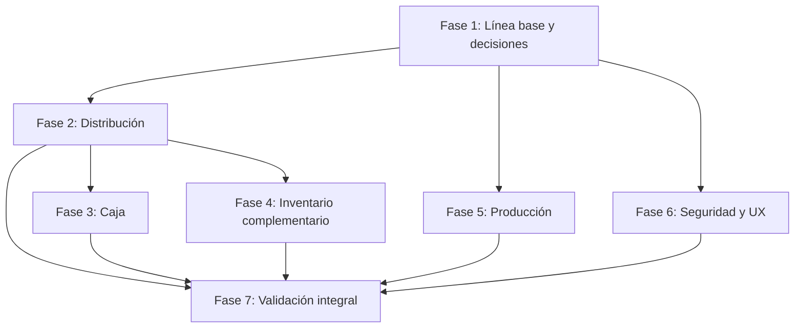

# MAPA DE DEPENDENCIAS ENTRE MÓDULOS — INDUSTRIAS BASAN

**Referencia:** [PLAN_MAESTRO_IMPLEMENTACION.md](./PLAN_MAESTRO_IMPLEMENTACION.md). Este mapa identifica servicios compartidos y efectos secundarios potenciales de las intervenciones planificadas en [MATRIZ_TAREAS_TECNICAS.md](./MATRIZ_TAREAS_TECNICAS.md). No se modificó código para producirlo.

---

## 1. Servicios compartidos (puntos de alto acoplamiento)

| Servicio/módulo compartido | Consumidores verificados | Evidencia | Riesgo si se modifica sin coordinar |
|---|---|---|---|
| `inventory-movement.service.ts` (`registerInventoryMovement`, `transferEnvaseBucket`, `ensurePlantEnvaseBucketQuantity`, `registerEnvaseBucketChange`) | Compras, ventas, ajustes, producción, despacho/devolución de ruta, envases | `purchase.service.ts`, `sale.service.ts`, `adjustment.service.ts`, `production.service.ts`, `route-inventory.service.ts`, `envase.service.ts` importan estas funciones | Es el único punto central de escritura de bitácora de inventario. Cualquier cambio de contrato (firma, validación) debe revisarse contra los seis módulos consumidores a la vez, no solo contra el que motivó el cambio. |
| `InventarioItem.Existencia` | Todos los módulos anteriores | `schema.prisma:566-616` | Es un único campo de existencia global; introducir "custodia por vehículo" (distribución) o "cantidad real de producción" no debe crear una segunda columna de existencia paralela; debe seguir pasando por el mismo campo y el mismo servicio de movimientos. |
| `RutaSesion` | Ventas (`Venta.IdRutaSesion`), despacho (`DespachoRuta`), devolución (`DevolucionRuta`), ajustes de ruta (`AjusteRuta`), gastos de vehículo (`GastoVehiculo`), movimientos de envase de ruta (`MovimientoEnvase.IdRutaSesion`), planilla/comisiones | `schema.prisma:1014-1050`; `planilla-mensual.service.ts` consulta `FechaSesion`/`IdUsuarioChofer`/`IdUsuarioVendedor` de la sesión | Es la entidad con más consumidores del sistema. Cualquier cambio de cardinalidad (ej. introducir jornada con varios vehículos) debe revisar los seis consumidores listados, no solo logística. |
| `runSerializableTransaction` (`backend/src/utils/serializable-transaction.ts`) | Despacho, devolución, ajuste de ruta, ajustes de inventario, producción, envases, creación de sesión de ruta | Uso verificado en `route-inventory.service.ts`, `adjustment.service.ts`, `production.service.ts`, `logistics.service.ts` | Es el mecanismo común de consistencia transaccional. Las nuevas operaciones de distribución (reabastecimiento, transferencia, relevo) y de caja deben usar el mismo wrapper, no abrir transacciones ad-hoc con otro nivel de aislamiento. |
| `requireModulePermission` / `rbacModuleKeys` | Todos los routers backend | `auth.middleware.ts:267-286`, `role-permission.validators.ts:5-23` | Agregar el módulo `caja` sin sincronizar frontend y backend deja el guard de una de las dos capas desalineado (ver T-F1-BASE-04). |
| `EnvaseClienteSaldo` / `MovimientoEnvase` | Ventas (préstamo generado en venta), envases (préstamo/devolución/pérdida/baja), despacho/devolución de ruta (buckets PLANTA/RUTA) | `sale.service.ts` (creación de préstamo en venta), `envase.service.ts`, `route-inventory.service.ts` | Cambios en el cálculo de saldo o en los buckets de ubicación/estado afectan simultáneamente ventas, envases y distribución. |
| `Venta` / `PagoVenta` / `CuentaPorCobrar` | Créditos (`credit.service.ts` deriva abonado de `PagoVenta`), planilla/comisiones, FEL, futura caja | `credit.service.ts`, `planilla-mensual.service.ts`, `fel.service.ts` | El diseño de caja (Fase 3) debe **leer** estos modelos, no duplicarlos; cualquier cambio en cómo se calcula el saldo de `PagoVenta` repercute en crédito y en el futuro cálculo de efectivo esperado. |

---

## 2. Matriz de impacto por dominio de la especificación

| Dominio modificado | Inventario | Ventas | Compras | Producción | Distribución | Envases | Caja (futuro) | Roles y permisos | Reportes |
|---|---|---|---|---|---|---|---|---|---|
| **Inventario** (ajustes, movimientos) | — | Afecta disponibilidad de venta | Afecta costo promedio y recepción | Afecta disponibilidad de insumos | Afecta disponibilidad de despacho | Afecta buckets de envase | Indirecto (gastos/ventas que dependen de stock) | No | Sí (reportes de kardex/existencias) |
| **Ventas** | Descuenta existencia (planta o ruta según `IdRutaSesion`) | — | No | No | Consume `RutaSesion`, exige sesión `EN_CURSO` | Genera préstamo de envase si `EsEnvaseRetornable` | Fuente principal de "ventas cobradas en efectivo" | Permisos `ventas:*` | Reportes de ventas/clientes |
| **Compras** | Incrementa existencia y costo promedio | No | — | Alimenta materia prima/insumo consumido en producción | No | No | `DetalleGasto` no vinculado a caja (ver T-F3-CAJA-08) | Permisos `compras:*` | Reportes de compras |
| **Producción** | Consume materia prima/insumo, incrementa producto terminado | No directo (solo indirectamente vía stock) | Depende de existencia de materia prima/insumo comprada | — | No | Si el producto terminado es envase retornable, llena buckets PLANTA | No | Permisos `produccion:*` (incluye `allow-negative-stock`, única acción restringida a este módulo) | Reportes de producción |
| **Distribución** (despacho/devolución/ajuste de ruta) | Descuenta/incrementa existencia de planta | Vínculo bidireccional vía `Venta.IdRutaSesion` | No | No | — | Mueve buckets PLANTA↔RUTA | Fuente de "gastos de vehículo" y contexto de "vehículo/jornada" para caja | Permisos `logistica:*`/`despacho:*` | Reportes de camiones/rutas |
| **Envases** | No afecta `Existencia` de producto comercial directamente, sí sus propios buckets | Genera/salda préstamos desde venta | No | Recibe envases llenos/vacíos de producción | Recibe/entrega buckets de ruta | — | No | Permisos `envases:*` | Reportes de envases |
| **Caja (futuro)** | No | Lee `PagoVenta` sin modificarlo | Lee `GastoVehiculo`/posible `DetalleGasto` sin modificarlos | No | Se vincula a `RutaSesion` para apertura/cierre | No | — | Requiere nuevo módulo `caja` (no existe) | Reportes financieros/de caja (no existen hoy) |
| **Roles y permisos** | Guard de endpoints | Guard de endpoints | Guard de endpoints | Guard de endpoints (incluida `allow-negative-stock`) | Guard de endpoints | Guard de endpoints | Guard de endpoints nuevo | — | Guard de endpoints de reportes |
| **Reportes** | Lee bitácora/existencias | Lee ventas/clientes | Lee compras | Lee movimientos de producción | Lee sesiones/despachos/gastos | Lee movimientos de envase | Leerá movimientos de caja (futuro) | No | — |

---

## 3. Efectos secundarios esperados de cada fase planificada

### Fase 2 (Distribución)

- **Ventas:** si se introduce jornada con varios vehículos o se permite reabastecimiento, `sale.service.ts` debe seguir resolviendo correctamente contra **qué despacho/tramo** descuenta cada venta; hoy asume un único despacho activo por sesión (`getRouteAvailableQuantities`). Debe revisarse junto con T-F2-DIST-05. La misma función debe excluir de la disponibilidad vendible cualquier cantidad en tránsito por una `TransferenciaVehiculo` `PENDIENTE` (ver [DISENO_TECNICO_DISTRIBUCION.md](./DISENO_TECNICO_DISTRIBUCION.md), sección 4.1), para que una venta no pueda despachar inventario que ya salió del vehículo pero todavía no se confirmó en otro.
- **Envases:** el despacho mueve buckets PLANTA→RUTA; permitir múltiples despachos implica que la suma de buckets por sesión también debe recalcularse sin duplicar.
- **Planilla/comisiones:** `planilla-mensual.service.ts` lee `FechaSesion`/`IdUsuarioChofer`/`IdUsuarioVendedor` de `RutaSesion`. Si se introduce relevo (cambio de responsable a mitad de jornada), debe decidirse qué responsable se atribuye a cada venta para efectos de comisión — **no inferir, es una decisión de negocio** (ver [DECISIONES_TECNICAS_PENDIENTES.md](./DECISIONES_TECNICAS_PENDIENTES.md#distribución)).
- **Gastos de vehículo:** `GastoVehiculo.IdRutaSesion` es obligatorio (no nulo); si una jornada tiene varios vehículos, debe decidirse si el gasto se asocia a la sesión del vehículo específico (recomendado, sin cambio de esquema) o a la jornada completa (requeriría cambio de esquema).

### Fase 3 (Caja)

- **Ventas/Créditos:** la caja debe leer `PagoVenta` filtrando por `MetodoPago` y `Anulado`; cualquier cambio futuro en cómo se anulan o reclasifican pagos de venta (dominio de ventas/créditos) afecta directamente el cálculo de efectivo esperado de caja. Se recomienda que el servicio de caja no tenga lógica propia de interpretación de `PagoVenta`, sino que reutilice las funciones de consulta ya existentes en `credit.service.ts`/`sale.service.ts` cuando sea posible.
- **Logística:** el cierre de caja se diseña vinculado a `RutaSesion`; si Fase 2 cambia la cardinalidad de sesión/jornada, el modelo `CajaSesion` propuesto en Fase 3 debe revisarse antes de implementarse.
- **Roles y permisos:** agrega una clave de módulo nueva (`caja`) a dos catálogos sincronizados; un error de sincronización no rompe otros módulos, pero deja el módulo nuevo sin protección efectiva en una de las dos capas.

### Fase 4 (Inventario y logística complementaria)

- **Ventas:** la materialización física de la devolución comercial (T-F4-INV-01) interactúa con el mismo `InventarioItem.Existencia` que ventas y compras; debe ejecutarse dentro del mismo patrón transaccional ya usado por `sale.service.ts` y `route-inventory.service.ts`.
- **Distribución:** el ajuste de ruta (`AjusteRuta`) es consumido por el cierre de sesión (`assertRouteCanClose`); un cambio en su unicidad (T-F2-DIST-08/T-F4-INV-03) debe revisarse contra esa función antes de desplegarse.

### Fase 5 (Producción)

- **Inventario:** los nuevos campos de cantidad real/consumo real/merma son aditivos sobre `OrdenProduccion`/`DetalleOrdenProduccion`; no deberían afectar a compras ni ventas directamente, pero si se agrega un movimiento de merma, debe usar `registerInventoryMovement` (el mismo servicio compartido) para no crear un segundo mecanismo de bitácora.
- **Envases:** si el producto terminado es un envase retornable, la producción ya llena buckets PLANTA (VACIO→LLENO); la merma de un producto retornable debe decidir a qué bucket/estado se clasifica (no inferir).

### Fase 6 (Seguridad y UX)

- **Todos los módulos:** homologar guards de página es, por diseño, de bajo acoplamiento — cada página se corrige de forma independiente. El riesgo no es técnico sino de cobertura incompleta si no se revisan las 20 páginas identificadas en conjunto.
- **Componentes de ayuda:** al construirse sobre primitivos ya compartidos (`components/ui/popover.tsx`, `components/ui/dialog.tsx`, `components/ui/sonner.tsx`), cualquier cambio en esos primitivos afecta simultáneamente a `ConfirmActionDialog` y a los nuevos componentes de ayuda. Deben revisarse en conjunto, no en aislado.

---

## 4. Dependencias cruzadas entre fases (resumen)

- F6 (seguridad/UX) **no depende** de F2-F5 de forma estricta y puede avanzar en paralelo, salvo el diccionario de términos (T-F6-UX-05), que necesita que "jornada" esté definida por F2.
- F3 (caja) depende de F2 solo en la medida en que F2 decida cambiar la cardinalidad de `RutaSesion`; si F2 solo agrega despachos múltiples sin tocar la cardinalidad de sesión/vehículo, F3 puede empezar su diseño de modelo en paralelo, pero no su implementación final.
- F7 (validación integral) depende de que cada fase funcional específica esté implementada antes de ejecutar su bloque de pruebas correspondiente (ver [PLAN_PRUEBAS_INTEGRALES.md](./PLAN_PRUEBAS_INTEGRALES.md)).

---

## 6. Guards de página frontend (evidencia completa para T-F6-SEG-01)

Verificación directa sobre las 55 páginas bajo `frontend/app/**/page.tsx` (grep de `RequireAuth`):

- **32 páginas** ya declaran `moduleKey`+`action` coincidente con una clave existente de `frontend/lib/rbac.ts` (clientes, empresa, ventas, roles, usuarios, compras, planilla, sesiones, producción, reportes, despacho, inventario parcial).
- **20 páginas** usan `RequireAuth` solo con sesión, sin `moduleKey`, aunque la clave de módulo correspondiente **ya existe** en `rbac.ts`:

| Página | Clave de módulo disponible en `rbac.ts` |
|---|---|
| `frontend/app/page.tsx` (`/`) | `resumen` |
| `frontend/app/analytics/page.tsx` | (sin clave evidente; revisar con negocio) |
| `frontend/app/employees/page.tsx` | `empleados` |
| `frontend/app/employees/create/page.tsx` | `empleados` |
| `frontend/app/employees/edit/[id]/page.tsx` | `empleados` |
| `frontend/app/envases/page.tsx` | `envases` |
| `frontend/app/inventory/page.tsx` | `inventario` |
| `frontend/app/inventory/create/page.tsx` | `inventario` |
| `frontend/app/inventory/edit/[id]/page.tsx` | `inventario` |
| `frontend/app/inventory/adjustments/page.tsx` | `inventario` |
| `frontend/app/inventory/structure/page.tsx` | `inventario` |
| `frontend/app/logistics/expenses/page.tsx` | `logistica` |
| `frontend/app/logistics/maintenance/page.tsx` | `logistica` |
| `frontend/app/logistics/routes/page.tsx` | `logistica` |
| `frontend/app/logistics/vehicles/page.tsx` | `logistica` |
| `frontend/app/quality/page.tsx` | `calidad` |
| `frontend/app/my-payroll/page.tsx` | `planilla` |
| `frontend/app/providers/page.tsx` | `proveedores` |
| `frontend/app/providers/create/page.tsx` | `proveedores` |
| `frontend/app/providers/edit/[id]/page.tsx` | `proveedores` |

- **3 páginas** no usan `RequireAuth` directamente: `frontend/app/(auth)/login` y `frontend/app/(auth)/register` son públicas por diseño (no requieren corrección); `frontend/app/purchases/gastos/page.tsx` es un **re-export** de `frontend/app/purchases/page.tsx` (`export { default } from "../page"`), que sí está protegida con `compras:read` — **se verificó directamente y se descarta como hallazgo**, no requiere acción.

Nota: `/credits`, `/credits/customers/[id]`, `/purchases/gastos/create` y `/commissions` usan `moduleKey` válido pero con una clave de un módulo distinto al nombre de la página (`ventas`, `compras`, `planilla` respectivamente); esto es consistente con que no existen claves separadas `creditos`/`gastos`/`comisiones` en el catálogo, y no se considera un defecto salvo que el negocio decida crear módulos RBAC más granulares.

---

## 7. Qué NO debe tocarse sin análisis adicional

Confirmado por evidencia de código, estos elementos tienen consumidores que **no fueron objeto de esta planificación** y cualquier cambio sobre ellos excede el alcance de las fases 2-6 descritas:

- `fel.service.ts` y los campos FEL de `Venta` (autorización/serie/número) — consumidos por el flujo fiscal de ventas, no tocado por este plan. **Para pruebas:** toda prueba de integración que ejercite un camino capaz de invocar `fel.service.ts` debe mockearlo explícitamente (ya verificado como patrón existente en `route-flow.sqlserver.integration.spec.ts`); revertir una transacción de base de datos no deshace una emisión FEL ya enviada.
- `n8n-webhook.client.ts` y `notification.service.ts` — emisores de eventos desde ventas y logística; si se agregan eventos de caja o distribución nueva, deben seguir el mismo contrato de serialización ya usado, no uno nuevo. **Para pruebas:** ambas pruebas de integración existentes ya mockean `notification.service.ts`; toda prueba nueva debe conservar este mocking (ver [PLAN_PRUEBAS_INTEGRALES.md](./PLAN_PRUEBAS_INTEGRALES.md), sección 0).
- `planilla-mensual.service.ts` — consumidor de `RutaSesion`, mencionado como afectado por Fase 2, pero su lógica de cálculo de comisiones en sí misma no es objeto de este plan.
- Módulo de calidad (`quality.service.ts`) — no se encontró relación operativa con producción o inventario en esta revisión; no se le asigna ninguna tarea en este plan.
