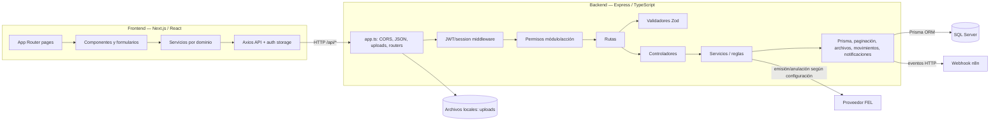

# Mapa de arquitectura

## Arquitectura observada

FlowManager es un monorepo pnpm con `frontend` y `backend`. El flujo normal de aplicación comprobado en código es:

1. Página/componentes Next.js llaman a servicios del frontend.
2. El adaptador Axios define el `baseURL`, adjunta el token de acceso y gestiona el evento de sesión no autorizada/renovación.
3. Express aplica CORS, parseo JSON y servicio estático para `/uploads`; monta 26 routers en sus prefijos API.
4. `requireAuth` valida el token/sesión; los guards de ruta evalúan permisos por módulo y acción.
5. Rutas delegan a controladores y validadores; los servicios implementan operaciones y consultas.
6. Prisma persiste/consulta en SQL Server. Los servicios pueden agrupar cambios en transacciones; el detalle debe revisarse por operación en la auditoría del módulo.
7. Algunos flujos contactan sistemas externos (FEL/n8n) o guardan archivos fuera de las tablas.

## Diagrama general

El diagrama omite deliberadamente reportes/dashboard/analítica y sus dependencias. Las integraciones externas se muestran solo donde el código/documentación ofrece evidencia; no implica que el entorno externo esté disponible o verificado.

## Componentes y responsabilidades

### Frontend

- [frontend/app/](../../frontend/app/) organiza páginas por dominio y usa App Router.
- [frontend/services/](../../frontend/services/) contiene clientes por dominio (`sales`, `purchases`, `clients`, `inventory`, `logistics`, etc.).
- [frontend/lib/api.ts](../../frontend/lib/api.ts) contiene la instancia Axios compartida, autenticación de solicitudes, refresh/reintento y señal de logout.
- [frontend/lib/auth-storage.ts](../../frontend/lib/auth-storage.ts), [frontend/lib/auth-store.ts](../../frontend/lib/auth-store.ts), [frontend/components/auth-provider.tsx](../../frontend/components/auth-provider.tsx) y [frontend/components/require-auth.tsx](../../frontend/components/require-auth.tsx) forman la capa compartida de estado/guard de sesión.
- [frontend/lib/rbac.ts](../../frontend/lib/rbac.ts), [frontend/components/dashboard-shell.tsx](../../frontend/components/dashboard-shell.tsx) y los tipos compartidos participan en permisos y navegación.
- `frontend/app/production/page.tsx` renderiza un placeholder, no evidencia de una capa completa de producción.

### Backend

- [backend/src/index.ts](../../backend/src/index.ts): carga la configuración de entorno, inicia el servidor y cierra el navegador compartido con señales de apagado.
- [backend/src/app.ts](../../backend/src/app.ts): CORS, JSON, estáticos, montaje de rutas, health-check y manejadores 404/errores.
- [backend/src/routes/](../../backend/src/routes/): definición de endpoints y guards.
- [backend/src/controllers/](../../backend/src/controllers/): adaption de HTTP a operaciones/servicios.
- [backend/src/validators/](../../backend/src/validators/): validación de entrada con Zod y constantes/contratos.
- [backend/src/services/](../../backend/src/services/): operaciones de dominio y persistencia.
- [backend/src/middlewares/auth.middleware.ts](../../backend/src/middlewares/auth.middleware.ts): JWT, sesión activa y autorización modular; [backend/src/middlewares/upload.middleware.ts](../../backend/src/middlewares/upload.middleware.ts): carga de imágenes.
- [backend/src/config/prisma.ts](../../backend/src/config/prisma.ts): instancia Prisma reutilizable en desarrollo.
- [backend/src/utils/](../../backend/src/utils/): paginación, paths e identificación de imágenes.
- [backend/src/modules/reports/](../../backend/src/modules/reports/): subsistema de informes excluido del análisis.

### Persistencia y cambios de esquema

- [backend/prisma/schema.prisma](../../backend/prisma/schema.prisma): datasource SQL Server y 42 modelos.
- [backend/prisma/migrations/](../../backend/prisma/migrations/): 14 migraciones SQL versionadas.
- [Base de Datos - FlowManager.sql](../../Base%20de%20Datos%20-%20FlowManager.sql): script SQL maestro.
- [backend/prisma/seed.ts](../../backend/prisma/seed.ts): semilla Prisma.
- [backend/scripts/](../../backend/scripts/): contiene SQL descritos en documentación como cambios históricos/manuales, más un script de copiado de plantillas. No se ejecutó ninguno.

La relación de autoridad entre el SQL maestro, las migraciones, el esquema actual y las bases desplegadas debe verificarse antes de cualquier modificación futura; esta exploración no inspeccionó una instancia SQL.

## Seguridad, validación y errores

- El README del backend documenta JWT access/refresh, bcrypt y RBAC.
- El código de middleware restringe algoritmo/issuer/audience y busca sesión activa cuando el token trae identificador de sesión; las rutas interiores aplican permisos.
- Los nombres permitidos de módulos/acciones están centralizados en `role-permission.validators.ts`.
- Las validaciones de entrada existen por dominio mediante Zod; la cobertura exacta no es uniforme y queda para la auditoría especializada.
- `app.ts` convierte errores de parseo JSON y Multer conocidos en respuestas controladas y tiene manejador general de errores. No se evaluó exhaustivamente el mapeo de errores por endpoint.

## Integraciones y almacenamiento no relacional

- **FEL:** [backend/src/services/fel.service.ts](../../backend/src/services/fel.service.ts) implementa construcción/transportes y emisión/anulación/validación; [backend/src/services/sale.service.ts](../../backend/src/services/sale.service.ts) conecta operaciones fiscales al flujo de ventas. La configuración se obtiene de variables de entorno; no se inspeccionaron valores ni certificados.
- **n8n:** [backend/src/services/notification.service.ts](../../backend/src/services/notification.service.ts) crea eventos y [backend/src/services/n8n-webhook.client.ts](../../backend/src/services/n8n-webhook.client.ts) realiza el POST; el contrato documental está en [docs/infraestructura/n8n-notificaciones.md](../infraestructura/n8n-notificaciones.md). No se inspeccionó el workflow remoto.
- **Archivos:** las imágenes subidas se escriben/serven fuera de SQL mediante la capa de upload y `uploadsRootPath`. Plantillas de informes/PDF pertenecen al ámbito excluido.

## Pruebas y convención

Se encontraron 32 archivos `backend/src/tests/*.spec.ts`, con pruebas de autenticación/RBAC, ventas/créditos, compras, inventario, calidad, logística, FEL/transporte, n8n, validadores e informes. Los manifiestos exponen `pnpm test` y `pnpm build` para backend; frontend expone lint/build. No se ejecutaron pruebas porque los cambios de esta fase son exclusivamente documentación.

Las convenciones arquitectónicas están explicadas en [backend/README.md](../../backend/README.md) y las bitácoras en [docs/auditoria/](../auditoria/). Esas bitácoras describen pasos concretos y pueden no representar el estado actual de todos los módulos.
